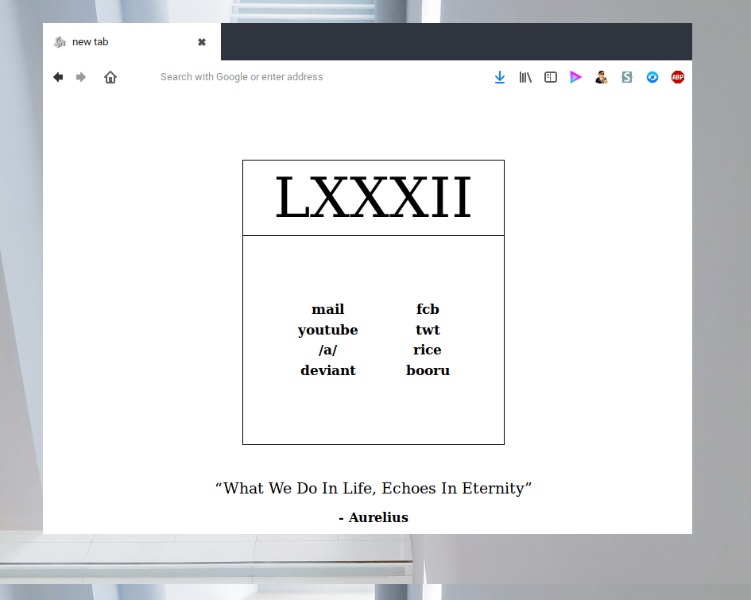
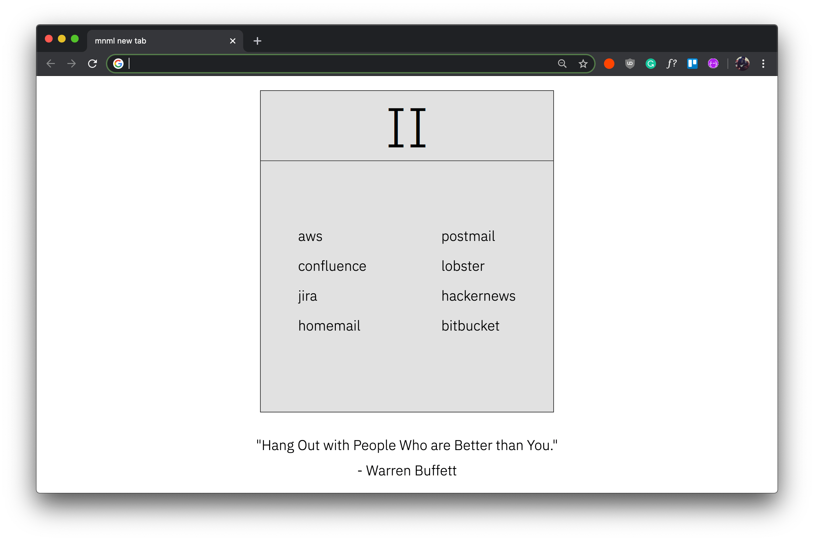
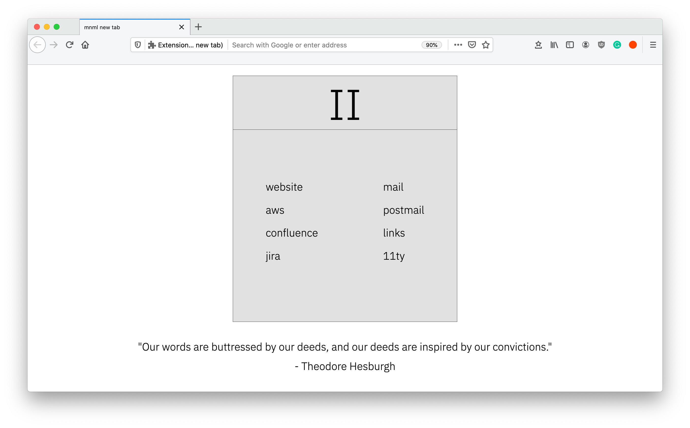
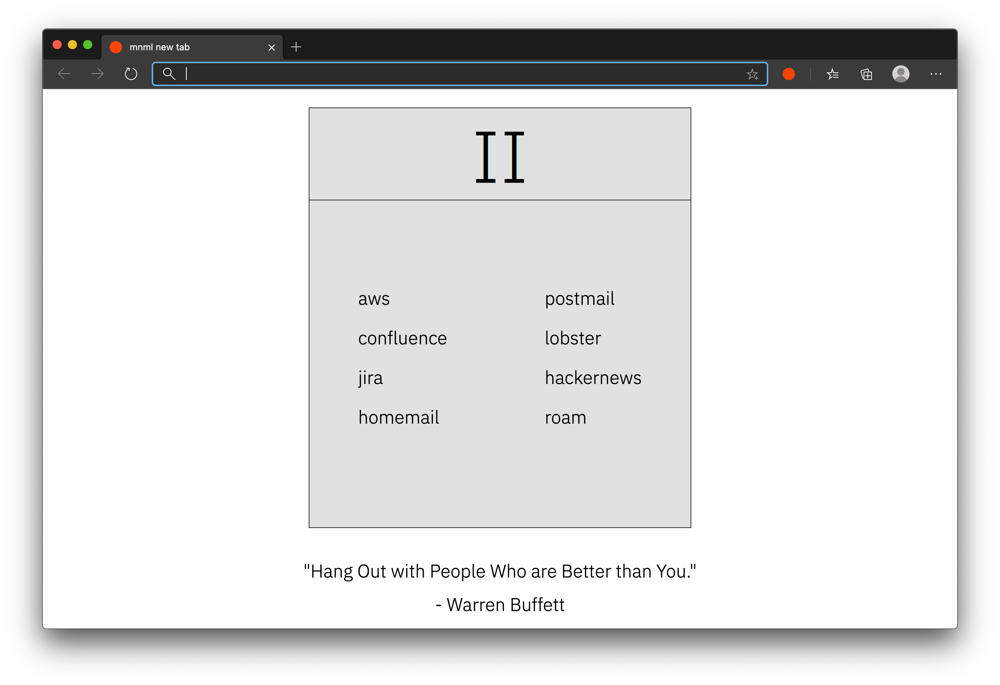

If you've seen my project titled [inspo](https://inspo-arpit.vercel.app/), you already know how impressed I am by [torvim's](https://torvim.github.io/) [inspo](https://u.teknik.io/E32bU.zip) collection.

One day, while randomly browsing images in this collection, I came across the following image:

The screenshot showed a new tab page with a pretty minimal layout.

I had been using other extensions to show bookmarks in the new tab page so that they could be easily accessible, so upon seeing the screenshot from the inspo collection, I decided to create a similar browser extension. There might already be an extension with the exact design (how else would that screenshot exist then?), but creating an extension that I will use daily seemed fun so I went through with it.

## Technical Details

Since Chrome, Firefox and Edge (since it's based on Chromium), have adopted the [WebExtensions](https://developer.mozilla.org/en-US/docs/Mozilla/Add-ons/WebExtensions) spec, it's easy to develop extensions for all of these browsers using a single codebase. There are some minor differences though. Firefox WebExtension APIs are promise based but Chrome is still using the older callback syntax, also functions on Chrome are under the `chrome` namespace, as compared to `browser` on Firefox. Thankfully, Firefox has a handy [polyfill](https://github.com/mozilla/webextension-polyfill) which helps iron out these quirks.

The quote that the new tab page displays is fetched from [quotes.rest](https://quotes.rest/). The extension is written in vanilla JavaScript. The new tab page shows the first 8 bookmarks from the `Bookmarks Bar` folder on Chrome, `Favourites Bar` on Edge and the `Bookmarks Toolbar` folder on Firefox.

The extension's code is open source and is available [on GitHub](https://github.com/arpitbatra123/mnml-new-tab).

## Screenshots

Here is how the new tab page looks on Chrome and Firefox and Edge:

## Download

* [Firefox Extension](https://addons.mozilla.org/en-GB/firefox/addon/mnml-new-tab/)
* [Chrome Extension](https://chrome.google.com/webstore/detail/mnml-new-tab/mceanpcekehmcfalnmllidcfipajpeml?hl=en)

### Update - 26th September 2020

Added dark mode support:

<video controls autoplay loop>
  <source src="/assets/images/mnml-new-tab-dark-mode.mp4" type="video/mp4">
  Your browser does not support the video tag.
</video>

### Update - November 2026

Quotes now come from the Mue API instead of quotes.rest, you can pick the bookmarks folder in options (added September 2021), and the extension moved to Manifest V3 in June 2023.
